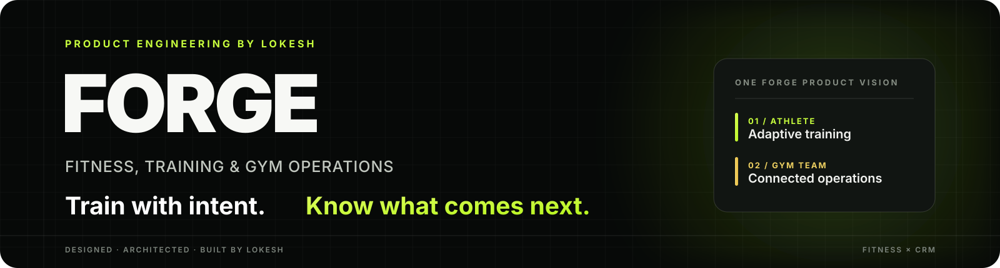
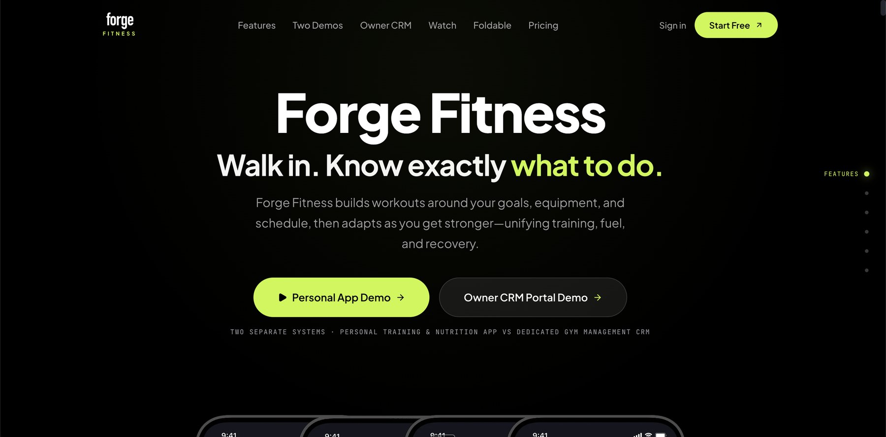
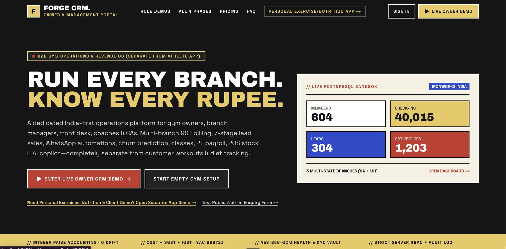
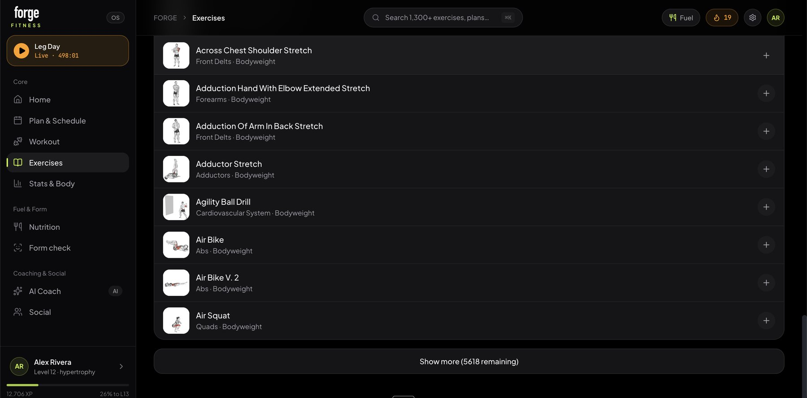
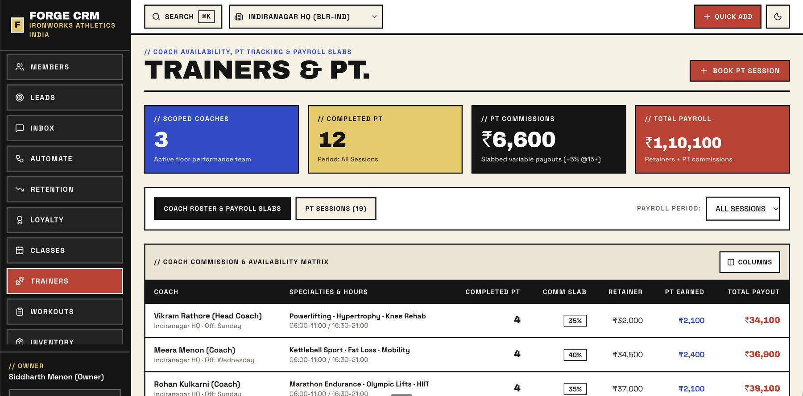
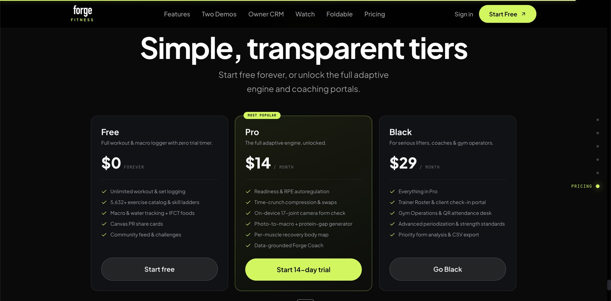

  

<h1 align="center">Forge Fitness + Forge CRM</h1>

  <strong>Training that adapts. Gym operations that connect.</strong> 
  A connected product vision for athletes, coaches, gym teams, and owners.

  
  
  
  
  
  
  
  

  <a href="https://forge-fitness-os-xgwy.vercel.app/">Open the live demo ↗</a> ·
  <a href="#product-experiences">Explore the product</a> ·
  <a href="#product-screenshots">View screenshots</a> ·
  <a href="#run-locally">Run locally</a> ·
  <a href="PLAN.md">Project plan</a>

---

## 🧭 Overview

A tracker records what happened. **Forge helps decide what should happen next.**

Forge brings together two focused experiences:

| Product | For | Purpose |
| --- | --- | --- |
| **Forge Fitness** | Athletes and coaches | Plan and log training, then connect effort, recovery, nutrition, and progress. |
| **Forge CRM** | Gym owners and teams | Coordinate members, leads, billing, branches, staff, and day-to-day gym operations. |

The athlete app adapts around a person’s goals, equipment, readiness, and schedule. The owner CRM gives gym teams a shared operating picture across members, revenue, attendance, and coaching. Each experience has its own interface and data layer, with a consistent Forge identity.

## ✨ A product build by Lokesh

**Conceived, designed, and built end to end by Lokesh**, Forge brings product thinking, interface design, application architecture, domain modeling, and implementation into one substantial build.

The work began with a simple question: how can software make the next useful action clearer? For athletes, that means turning training context into a practical session. For gym teams, it means making the people, schedules, and business behind those sessions easier to manage.

Across both experiences, Lokesh shaped the product direction, mapped the workflows, built the visual systems, and carried the details through to working application flows. Forge reflects a hands-on approach to engineering: learn the domain, make the important decisions visible, and give every screen a clear job.

## 🏋️ Product experiences

### Forge Fitness · Adaptive training

Forge Fitness connects planning, training, food, recovery, and progress in one athlete-facing app.

- **Training that responds to context** — readiness signals, RPE, available time, equipment, and movement swaps inform a session as it unfolds.
- **Focused workout logging** — set tracking, rest timers, plate math, previous-set context, voice and natural-language logging, and personal-record moments.
- **Nutrition and recovery** — macro and water tracking, meal logging, a photo-to-macro confirmation flow, protein-gap suggestions, and a per-muscle recovery map.
- **Progress with useful context** — estimated one-rep max, training volume, body metrics, strength standards, streaks, and shareable personal-record cards.
- **Form check and coaching** — movement cues and a data-grounded coach surface information from the athlete’s training context.
- **Training community** — check-ins, challenges, a leaderboard, social posts, and gym activity.

### Forge CRM · Gym operations

Forge CRM is a separate owner and management portal built around the workflows of a multi-branch gym.

- **Members and sales** — member records, public enquiries, lead stages, follow-up inbox, membership plans, and conversion workflows.
- **Billing and finance** — invoices, payment tracking, GST support, reports, and a branch-aware view of revenue.
- **People and programming** — staff roles, trainer availability, personal-training sessions, classes, and training plans.
- **Day-to-day operations** — check-ins, QR attendance, inventory, retention, loyalty, and workflow automation.
- **Multi-branch controls** — organization and branch scoping with role-based access for owners, managers, front desk, trainers, and finance.
- **Connected services** — PostgreSQL-backed records, Redis and BullMQ jobs, and adapters for payments, messaging, and document storage.

## 📸 Product screenshots

The screenshots below come from the supplied product views. Names, counts, and dashboard figures shown in these views are illustrative demo data.

<table>
  <tr>
    <td width="50%" valign="top">
      <strong>Forge Fitness · Product landing</strong> 
      
    </td>
    <td width="50%" valign="top">
      <strong>Forge CRM · Owner overview</strong> 
      
    </td>
  </tr>
  <tr>
    <td width="50%" valign="top">
      <strong>Forge Fitness · Exercise library</strong> 
      
    </td>
    <td width="50%" valign="top">
      <strong>Forge CRM · Trainers and PT</strong> 
      
    </td>
  </tr>
  <tr>
    <td colspan="2" valign="top">
      <strong>Forge Fitness · Plans and pricing</strong> 
      
    </td>
  </tr>
</table>

## ⚙️ How the two systems fit together

~~~mermaid
flowchart LR
  subgraph fitness["Forge Fitness · Athlete experience"]
    F[Next.js and React app] --> FA[Server actions and training logic]
    FA --> FD[(SQLite and Drizzle)]
  end

  subgraph crm["Forge CRM · Gym operations"]
    C[Next.js and React app] --> CA[Server actions and business rules]
    CA --> CD[(PostgreSQL and Prisma)]
    CA --> Q[Redis and BullMQ]
    Q --> W[Background worker]
    CA --> S[MinIO document storage]
  end
~~~

The Fitness app uses a local SQLite database for a quick, self-contained setup. The CRM runs as its own service with PostgreSQL and Redis-backed background work. The root Vercel configuration routes the <code>/crm</code> path to the CRM service and other paths to the Fitness app.

## 🧰 Technology

| Area | Forge Fitness | Forge CRM |
| --- | --- | --- |
| Application | Next.js 16, React 19, TypeScript | Next.js 16, React 19, TypeScript |
| Styling and icons | Tailwind CSS v4, Lucide | Tailwind CSS v4, Lucide |
| Data | SQLite, Drizzle ORM, better-sqlite3 | PostgreSQL 16, Prisma |
| Jobs and storage | — | Redis, BullMQ, MinIO-compatible object storage |
| Validation | Zod | Zod |
| Product logic | Training, readiness, recovery, and nutrition workflows | Membership, billing, GST, retention, and branch operations |

## 🚀 Run locally

Each experience can be started independently. Use Node.js 20 or later.

### Forge Fitness

The Fitness app uses SQLite and includes seeded demonstration data.

~~~bash
cd app
npm install
npm run db:push
npm run db:seed
npm run dev
~~~

Open **http://localhost:3000**. Choose the demo athlete **Alex Rivera** or use **alex@forge.app** on the sign-in screen.

### Forge CRM

The CRM’s Docker Compose setup starts the web app, PostgreSQL, Redis, MinIO, and the background worker.

~~~bash
cd crm
cp .env.example .env
docker compose up --build
~~~

Open **http://localhost:3001**. The seeded demo password is **ForgeCrm@2026**.

| Demo login | Role |
| --- | --- |
| owner@ironworks.in | Owner · all branches |
| manager.blr@ironworks.in | Manager · Indiranagar branch |
| frontdesk.blr@ironworks.in | Front desk |
| trainer.blr@ironworks.in | Trainer |
| accountant@ironworks.in | Accountant · read-only finance |

Provider-backed features need their corresponding credentials to connect to external services. The CRM setup and environment variable list are documented in [crm/README.md](crm/README.md).

## 🗂️ Project structure

~~~text
forge-fitness-os/
├── app/                    # Athlete training, nutrition, recovery, and progress app
├── crm/                    # Gym owner and operations portal
├── docs/                   # Product, architecture, data, design, and roadmap docs
├── tools/                  # Engineering and maintenance utilities
├── assets/readme/          # README banner and product screenshots
├── PLAN.md                 # Build plan and milestones
└── vercel.json             # Routes Fitness and CRM services
~~~

## 📚 Product and engineering notes

| Document | What it covers |
| --- | --- |
| [Build plan](PLAN.md) | Milestones, status, risks, and next steps |
| [Product requirements](docs/03-prd.md) | Personas, jobs to be done, requirements, and acceptance criteria |
| [Architecture](docs/04-architecture.md) | Current demo topology and production service boundaries |
| [Data model](docs/05-data-model.md) | Entities, indexes, retention, and migrations |
| [Adaptive systems](docs/06-ai-systems.md) | Readiness, recovery, training adaptation, form flow, and coach |
| [Design system](docs/07-design-system.md) | Visual tokens, typography, components, motion, and accessibility |
| [Roadmap](docs/08-roadmap.md) | Product and engineering direction |
| [Pricing strategy](docs/09-gtm-pricing.md) | Plans, pricing, acquisition, and retention assumptions |

## 🔎 Demo behavior and boundaries

Forge includes real application flows and seeded records, with some capabilities intentionally represented as product demos:

- Fitness sign-in uses a demo session flow; production authentication and account security are documented as future architecture.
- Form-check metrics and pose feedback use a deterministic demo analysis. The camera preview remains on the device.
- Food photo recognition and macro suggestions use a curated demo flow; external nutrition provider connections are not configured by default.
- The Forge Coach uses deterministic responses grounded in the athlete’s saved training data.
- Fitness demo records are local SQLite data. CRM figures and seeded accounts are demonstration records.
- CRM payment, messaging, and storage adapters need service credentials for live provider behavior.

This keeps the current experience clear while leaving the deeper implementation notes in the product and architecture documents.

---

  <strong>Built with care by Lokesh.</strong> 
  Forge Fitness · Forge CRM · Train with intent. Know what comes next.

