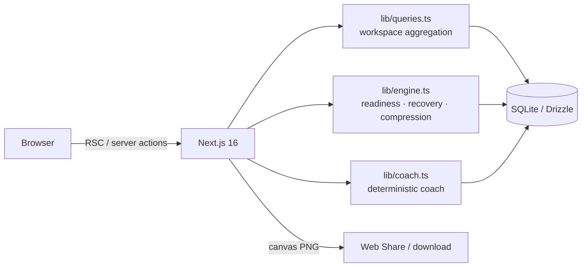

# FORGE — The Adaptive Training OS

> A tracker records what happened. **Forge decides what should happen next.**

Forge is a full-stack, local-first gym super-app: adaptive programming, frictionless set logging, on-device form analysis, photo-to-macro nutrition, a per-muscle recovery model, and a social layer that rewards consistency rather than noise.

Built as a working product demo in Next.js 16, not a clickable mockup. Every screen reads real rows from SQLite; the adaptive engine, PR detection, protein-gap generator and recovery map are deterministic, inspectable code.

---

## Quickstart

```bash
cd app
npm install
npx drizzle-kit push --force
npx tsx src/db/seed.ts
npm run dev
```

Open **http://localhost:3000**.

| Entry | What you get |
| --- | --- |
| `/` | Marketing site and an interactive, genuinely adaptive session demo |
| `/login` | Email sign-in (no password in demo) or one-tap demo athlete |
| `/app` | Dashboard — readiness, today's session, fuel, recovery, community |
| `/app/train` | Weekly plan + session launcher |
| `/app/train/[id]` | Live logging: rest timer, RPE autoreg, plate math, voice log, swaps |
| `/app/nutrition` | Macro ring, meal log, photo scanner, protein-gap generator |
| `/app/progress` | e1RM trends, volume, body metrics, strength standards, PR cards |
| `/app/form-check` | Camera studio with pose overlay, depth/path metrics and cues |
| `/app/social` | Feed, check-ins, leaderboard, challenges, gym radar |
| `/app/coach` | Chat grounded in the athlete's real training data |
| `/app/settings` | Profile, equipment, macro targets, account |

**Demo athlete:** `alex@forge.app` (or click “Enter as Alex Rivera”).
The database ships with 7 athletes, 63 exercises, 35 workouts, 561 logged sets, 15 program days, 85 body-metric readings and social data.

> Requires Node 20+. SQLite is used for zero-setup local development. No Docker, cloud account or API key needed. Camera form check is a simulation by default; enabling the webcam shows a live pose overlay and never uploads video.

---

## Why this exists

The fitness app market is structurally fragmented. A lifter stitches together a logger (Hevy/Strong), a planner (Boostcamp/Fitbod), a food tracker (MyFitnessPal), a wearable and a social app (Strava/Instagram). Each product owns one input and none owns the decision.

Forge closes the loop:

```
sense → decide → adapt
  ↑                  │
  └──── log/feedback ┘
```

- **Sense:** RPE, sleep, HRV, bodyweight, equipment, available time, logged food, camera joint data.
- **Decide:** readiness score, per-muscle recovery, session compression, load prescription, protein gap.
- **Adapt:** swap movements, adjust load/sets/rest, re-plan tomorrow, surface one cue at a time.

The differentiator is not a longer feature list. It is that **inputs change the prescription immediately**, visibly, and explainably.

---

## Feature map

| Pillar | In the demo |
| --- | --- |
| **Adaptive training** | Readiness model from sleep/HRV/soreness; load multiplier; RPE-driven next-set suggestion; “how much time do you have?” compression into supersets with trimmed rest; same-pattern equipment swaps mid-session |
| **Zero-friction logging** | Optimistic set completion, weight/rep steppers, previous-set ghosts, rest timer, plate breakdown, natural-language and voice parsing (“bench 185 for 8 at RPE 7”), undo, auto PR celebration |
| **Form intelligence** | Simulated 17-joint squat/bench/deadlift analysis: rep count, depth, torso angle, knee valgus, bar path, tempo, scored rubric, prioritized cues, attach-to-session |
| **Recovery** | Per-muscle fatigue decay from volume × intensity × recency, front/back body map, “train what's ready” next-session logic |
| **Nutrition** | Macro ring, water, meal log; photo-to-macro confirmation flow with regional foods; protein-gap generator that builds the smallest meal that closes the day; targets feed the coach |
| **Progress** | e1RM and volume trends, bodyweight/waist/body-fat, strength standards by sex/bodyweight, level/XP/streak, canvas-rendered Instagram-ready PR cards with native share |
| **Social** | Posts, comments, likes, follows, live check-ins, gym occupancy radar, leaderboard, joined challenges and streaks |
| **Coach** | Deterministic, data-grounded chat: cites readiness, protein remaining, recovery, next session and your equipment; quick prompts; persisted history |
| **Platform** | Responsive app shell, dark premium design system, server actions, typed Drizzle schema, seeded demo, marketing site, auth + session cookie, settings |

---

## Stack

| Layer | Choice | Why |
| --- | --- | --- |
| UI | Next.js 16 (App Router, Turbopack), React 19, TypeScript | Server components for data-heavy screens, client islands only where interaction demands it |
| Styling | Tailwind CSS v4 + CSS custom tokens | Fast, consistent design system without a component-library look |
| Data | SQLite + Drizzle ORM + `better-sqlite3` | Zero-setup demo; SQL-first schema that ports cleanly to Postgres |
| Charts/art | Hand-built SVG + canvas | No chart bundle; full control of the visual language; PR card is a real PNG export |
| Icons | Lucide | Consistent 1.5px stroke system |
| Fonts | Bricolage Grotesque · Inter · JetBrains Mono (`next/font`) | Editorial display, neutral UI, numeric/mono labels |
| Mutations | React server actions + `revalidatePath` | No hand-written API layer for the demo; progressive-enhancement friendly |
| Auth | Signed-in user in httpOnly cookie (`forge_uid`) | Demo-only shortcut; production design in `docs/04-architecture.md` |

No `framer-motion`, no `recharts`, no UI kit. The polish is CSS, SVG and interaction design.

---

## Architecture (demo)



`getWorkspace(userId)` assembles the athlete's world in one place: user, program, active workout, sets, metrics, nutrition, PRs, social graph, challenges, coach history. Pages stay thin; engine functions stay pure and testable.

Production topology, service boundaries, queues, caching and security are specified in [`docs/04-architecture.md`](docs/04-architecture.md).

---

## Project layout

```
app/
├── src/
│   ├── app/
│   │   ├── page.tsx                 # marketing site
│   │   ├── login/page.tsx
│   │   ├── actions.ts               # all server actions
│   │   └── app/                     # authenticated product
│   │       ├── page.tsx             # dashboard
│   │       ├── train/               # plan · live session · summary
│   │       ├── nutrition/  progress/  social/
│   │       ├── exercises/  programs/  coach/
│   │       └── form-check/  settings/
│   ├── components/                  # ui, charts, body map, feature clients
│   ├── db/                          # schema, client, 532-line seed
│   └── lib/                         # engine, queries, auth, coach, date, utils
├── drizzle.config.ts
└── forge.db                         # generated local database
```

~12.6k lines of TypeScript/TSX in `src`.

---

## Scripts

| Command | Purpose |
| --- | --- |
| `npm run dev` | Dev server (Turbopack) |
| `npm run build` | Production build + type check |
| `npm run start` | Serve production build |
| `npx drizzle-kit push --force` | Apply schema to SQLite |
| `npx tsx src/db/seed.ts` | Reset + seed demo data |

Seeding is idempotent: it clears and rebuilds demo rows.

---

## Design principles

1. **The number is the hero.** Weight, reps, readiness, protein left — typography does the work; decoration stays quiet.
2. **One cue, not a report.** Form feedback surfaces the highest-leverage fix, then evidence.
3. **Never punish a missed session.** Compression and swaps preserve the stimulus instead of breaking the streak.
4. **Evidence over vibes.** Every adaptive claim shows its inputs (“sleep debt detected”, “last RPE 7.5”).
5. **Local-first privacy.** Camera video never leaves the device; the demo database is a file you own.
6. **Accessible by default.** Semantic controls, focus-visible rings, `aria-label`s on icon buttons, reduced-motion respect, contrast-checked text.

Full tokens, type scale and component rules: [`docs/07-design-system.md`](docs/07-design-system.md).

---

## Research & documentation

| Document | Contents |
| --- | --- |
| [`PLAN.md`](PLAN.md) | Build plan, milestone status, risks, next steps |
| [`docs/01-market-research.md`](docs/01-market-research.md) | Market size, segments, trends, competitor teardown, whitespace |
| [`docs/02-competitive-matrix.md`](docs/02-competitive-matrix.md) | Feature-by-feature matrix and positioning |
| [`docs/03-prd.md`](docs/03-prd.md) | Personas, jobs-to-be-done, requirements, acceptance criteria |
| [`docs/04-architecture.md`](docs/04-architecture.md) | Demo vs. production architecture, APIs, realtime, security, scale |
| [`docs/05-data-model.md`](docs/05-data-model.md) | ERD, tables, indexes, retention, migrations |
| [`docs/06-ai-systems.md`](docs/06-ai-systems.md) | Readiness, recovery, autoregulation, vision, LLM coach, evaluation |
| [`docs/07-design-system.md`](docs/07-design-system.md) | Tokens, typography, components, motion, accessibility |
| [`docs/08-roadmap.md`](docs/08-roadmap.md) | 18-month product and engineering roadmap |
| [`docs/09-gtm-pricing.md`](docs/09-gtm-pricing.md) | Segments, pricing, acquisition, retention, unit economics |
| [`docs/10-research-repos.md`](docs/10-research-repos.md) | Learnings from 8 open-source repos + licensing notes |

---

## Licensing & provenance

Forge is an original implementation. Eight open-source gym/nutrition projects were cloned into `_research/` for feature analysis only; no code was copied.

- **Permissive (MIT):** GymFlow, gymcoach, lyftr, laragym.
- **Copyleft:** wger and openGym are **AGPL-3.0**; OpenNutriTracker is **GPL-3.0**. Studying behavior is fine; incorporating code would force copyleft obligations on the network service.
- **Custom:** GYM-One has a restrictive custom license (no integration/rebranding). Treated as reference only.

Details per repo: [`docs/10-research-repos.md`](docs/10-research-repos.md).

---

## Known demo limitations

- Auth is a demo cookie; there is no password, OAuth, email verification or rate limiting.
- Camera analysis is a deterministic simulation of the pose pipeline, not a trained model. The webcam feed is real and local; joint inference is mocked.
- Food scanning uses a curated regional food set and a simulated recognition step; barcode/OCR and nutrition-provider integration are production work.
- AI coach replies are deterministic templates over real data, not an LLM call. Production guardrails and tool-calling design are documented.
- Social features are single-instance SQLite with optimistic UI; no websocket fan-out, moderation queue or object storage.
- Units: storage is kilograms; the settings preference is persisted but not yet applied across every display.
- SQLite is intentionally not concurrent-write scalable. Postgres/Redis/ClickHouse migration is specified, not implemented.

These are scoped demo boundaries, not hidden claims. The docs separate “working now” from “production path”.

---

**Forge v1.0 · Show up. Level up.**
