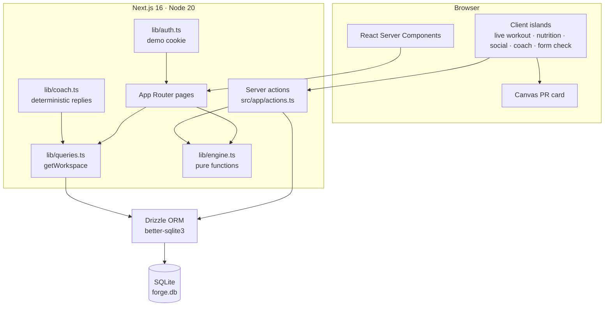
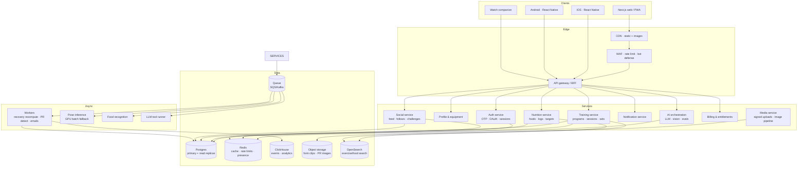

# Architecture

**Status:** demo implemented · production topology specified
**Related:** [`05-data-model.md`](05-data-model.md), [`06-ai-systems.md`](06-ai-systems.md)

---

## 1. Design principles

1. **One workspace read, many thin pages.** `getWorkspace(userId)` assembles the athlete's world once; pages render it. This keeps server components simple and makes caching/authorization auditable.
2. **Pure engine, impure edges.** Readiness, recovery, e1RM, compression, swaps and protein plans are pure functions in `lib/engine.ts`. They take data, return data, and are unit-testable without a database.
3. **Server owns truth; client owns feel.** Mutations go through server actions. The client may update optimistically but reconciles with the server response.
4. **Local-first where it matters.** The demo is a single SQLite file. Production moves hot writes to Postgres but keeps an offline mutation queue on device.
5. **Explain every adaptive output.** Each engine result carries inputs and a human-readable reason. No black-box prescriptions.
6. **No unnecessary dependencies.** Hand-built SVG charts, no chart bundle, no animation library, no UI kit.

---

## 2. Demo architecture (implemented)



### Request lifecycle

1. A page (server component) calls `getWorkspace(await getCurrentUser())`.
2. `getWorkspace` runs a bounded set of Drizzle selects, filters by user, and returns a typed object.
3. Pure engine functions derive readiness, recovery, e1RM, strength level, protein plan.
4. Client islands receive serializable props; interactive logging calls server actions.
5. Actions validate input, mutate via Drizzle, `revalidatePath`, and return a small result object.

### Implemented modules

| Module | Responsibility |
| --- | --- |
| `src/app/actions.ts` | All mutations: auth, profile, equipment, targets, workout start/log/finish, swap, compress, nutrition, water, social, coach, check-in |
| `src/lib/queries.ts` | Workspace aggregation, nutrition totals, weekly volume, muscle volume, PRs, challenges, leaderboard, program days |
| `src/lib/engine.ts` | Readiness, verdict, recovery map, alternatives, session estimate, compression, plates, strength standards, e1RM, protein plan |
| `src/lib/coach.ts` | Deterministic data-grounded reply generator |
| `src/lib/auth.ts` | Cookie session (`forge_uid`), demo fallback |
| `src/lib/date.ts` | Local day keys, week windows, relative labels |
| `src/db/schema.ts` | 21 tables, indexes, relations |
| `src/db/seed.ts` | Idempotent demo dataset |

### Why SQLite for the demo

- Zero setup: `npm install && push && seed` gives a full product.
- One file is easy to inspect, reset and ship.
- Drizzle schema is SQL-first and ports to Postgres with limited changes.
- Trade-off: single-writer, no concurrent scale, no row-level security. Explicitly a demo boundary.

---

## 3. Production architecture



### Service boundaries (modular monolith first)

Do not start with 8 microservices. Start with a **modular monolith** (Next.js or NestJS) with clear module boundaries and one Postgres. Split only when a module has independent scaling, failure isolation or team ownership needs.

Recommended split order:
1. **AI/vision** (GPU, spiky, different deploy cadence).
2. **Notifications** (fan-out, provider quirks).
3. **Social feed** (read-heavy, cache-heavy).
4. **Training write path** (highest correctness sensitivity) only if needed.

### Recommended production stack

| Layer | Choice | Rationale |
| --- | --- | --- |
| Web | Next.js (App Router) on Vercel/Fly/Cloud Run | RSC, edge caching, fast iteration |
| Mobile | React Native + Expo, shared TS domain package | One team, shared types/logic, HealthKit/Health Connect |
| API | Next route handlers + server actions initially; NestJS if split | Minimize ceremony until scale demands it |
| DB | Postgres 16 (Neon/RDS) + Drizzle | Relational integrity, JSONB flexibility, read replicas |
| Cache | Redis (Upstash/ElastiCache) | Workspace cache, rate limits, presence, leaderboards |
| Queue | SQS or Kafka (Redpanda) | Durable async work, retries, DLQ |
| Analytics | ClickHouse + event pipeline | High-volume product analytics without OLTP load |
| Search | Postgres FTS first; OpenSearch later | Exercise/food search; avoid premature infra |
| Objects | S3/R2 + signed URLs | Form clips, PR images, exports |
| Auth | Clerk/Auth0 or custom OTP + OAuth | Don't build auth from scratch; passkeys later |
| Billing | Stripe + RevenueCat (mobile) | Entitlements, trials, win-back |
| LLM | Provider-agnostic gateway (OpenAI/Anthropic/Gemini) | Cost/latency routing, fallbacks |
| Vision | MediaPipe/MoveNet on-device; server fallback | Privacy + latency + cost |
| Observability | OpenTelemetry + Sentry + Grafana | Traces, errors, SLOs |
| CI/CD | GitHub Actions + IaC (Terraform) | Reproducible environments |
| Feature flags | GrowthBook/Unleash | Experiments and kill switches |

---

## 4. API design

### Conventions
- JSON over HTTPS; `snake_case` in DB, `camelCase` in API.
- Cursor pagination for feeds/history: `?cursor=<opaque>&limit=20`.
- Idempotency key on all writes that can be retried: `Idempotency-Key: <uuid>`.
- Errors: `{ error: { code, message, details?, requestId } }` with stable codes.
- Versioning: `/v1`; additive changes only within a version.
- All timestamps ISO-8601 UTC; client renders local.

### Core endpoints (illustrative)

```
POST   /v1/auth/otp/request          { email }
POST   /v1/auth/otp/verify           { email, code } → session
POST   /v1/auth/oauth/:provider

GET    /v1/me                        profile, targets, equipment, entitlements
PATCH  /v1/me                        profile fields
PUT    /v1/me/equipment              available equipment set

GET    /v1/workspace?date=YYYY-MM-DD  dashboard aggregate (cached 30–60s)
GET    /v1/programs                  marketplace list
GET    /v1/programs/:id              days + exercises
POST   /v1/programs/:id/enroll

POST   /v1/sessions                  { programDayId? } → active session (idempotent)
GET    /v1/sessions/:id              session + exercises + sets
POST   /v1/sessions/:id/sets         { exerciseId, setIndex, weightKg, reps, rpe? }
PATCH  /v1/sessions/:id/sets/:setId  correction
DELETE /v1/sessions/:id/sets/:setId
POST   /v1/sessions/:id/swap         { workoutExerciseId, replacementExerciseId }
POST   /v1/sessions/:id/compress     { targetMinutes }
POST   /v1/sessions/:id/finish       → summary + PRs
GET    /v1/sessions/:id/summary

GET    /v1/progress/e1rm?exerciseId=&range=12w
GET    /v1/progress/volume?range=12w
GET    /v1/progress/body?range=90d
GET    /v1/standards?exerciseId=

GET    /v1/nutrition/:date
POST   /v1/nutrition/:date/meals
DELETE /v1/nutrition/:date/meals/:id
POST   /v1/nutrition/:date/water
GET    /v1/nutrition/protein-plan?remaining=
POST   /v1/foods/scan                multipart image → candidates + confidence
GET    /v1/foods/search?q=

GET    /v1/feed?cursor=
POST   /v1/posts
POST   /v1/posts/:id/like
POST   /v1/posts/:id/comments
POST   /v1/checkins                  { gymId }
GET    /v1/leaderboard?window=week&scope=friends
GET    /v1/challenges
POST   /v1/challenges/:id/join

POST   /v1/coach/messages           { text } → streamed reply + citations
GET    /v1/coach/messages

POST   /v1/form/analyses            { lift, source: on-device } → metrics (or upload URL)
GET    /v1/form/analyses/:id

POST   /v1/exports                  async export job
DELETE /v1/me                       async deletion job
```

### Server action ↔ API mapping

The demo uses server actions; production can expose the same operations as REST/GraphQL. Keep the **domain functions** independent of transport:

```
actions.ts  →  domain/commands.ts  →  db
route.ts    →  domain/commands.ts  →  db
worker      →  domain/commands.ts  →  db
```

This prevents logic duplication when mobile arrives.

---

## 5. Sync & offline (production)

### Requirements
- Log a set with no network; never lose it; never duplicate it.
- Resolve conflicts deterministically; server wins on completed workouts, client wins on pending sets.
- Sync across devices within seconds when online.

### Design
1. **Local store:** SQLite (Expo) or IndexedDB (web) mirror of active session, program, exercise metadata.
2. **Mutation queue:** append-only, each entry has `clientMutationId` (UUID), `type`, `payload`, `createdAt`, `attempts`.
3. **Push:** batch to `POST /v1/sync` with idempotency keys. Server upserts by `clientMutationId`; duplicate submissions return the original result.
4. **Pull:** cursor-based change feed per user (`updated_at > cursor`), scoped to active session and recent history.
5. **Conflicts:**
   - Set log: last-write-wins by server receipt, but corrections carry `supersedes` id.
   - Session finish: server-authoritative; late sets after finish are rejected with a recoverable error.
   - Program edits: version vector; user edits fork rather than overwrite.
6. **Presence/rest timer:** not synced as truth; derived locally, broadcast best-effort via WebSocket.

### Realtime
- **WebSocket/SSE** for: feed updates, check-in presence, challenge progress, coach streaming.
- **Channels:** `user:{id}`, `gym:{id}`, `feed:{userId}`.
- **Presence TTL:** 90 s heartbeat; Redis sorted set; occupancy = distinct users in last 30 min.
- **Fallback:** polling every 15 s; no feature depends on realtime.

---

## 6. Caching

| Data | TTL | Invalidation |
| --- | --- | --- |
| Workspace aggregate | 30 s per user per day | Any mutation revalidates |
| Exercise library | 24 h CDN + 5 min memory | Versioned by `libraryVersion` |
| Program catalog | 5 min | Admin publish event |
| Leaderboard | 60 s | Rolling recompute |
| Feed page 1 | 15 s | New post by followed user |
| Food search | 10 min | Index update |
| Strength standards | 24 h | Static config |

Rules: cache **read-heavy, low-personalization** data; never cache another user's private data without a user-scoped key; stampede protection via single-flight locks.

---

## 7. Security

### Authentication
- Email OTP (6 digits, 10-min expiry, 5 attempts) + OAuth (Apple, Google) + passkeys later.
- Short-lived access JWT (15 min) + rotating refresh token (30 days), httpOnly, Secure, SameSite=Lax.
- Device sessions list with revoke-all.
- Rate limits: 5 OTP requests/hour/email, 10 verify attempts/hour/IP, exponential backoff.

### Authorization
- Every query scoped by `user_id` at the repository layer, not just route middleware.
- Postgres row-level security as defense-in-depth for multi-tenant tables.
- Coach access via explicit client consent grants with expiry and audit log.
- Admin actions require role + step-up auth.

### Data protection
- TLS 1.3 in transit; encryption at rest (provider-managed + column-level for tokens).
- Secrets in a managed vault; no secrets in client bundles.
- PII minimization: no camera frames by default; coordinates derived and optionally discarded.
- Data export (JSON/CSV) and deletion (hard delete + tombstones for referential integrity) self-serve.
- Backups: PITR 30 days; quarterly restore drills.

### Application security
- CSRF: SameSite cookies + origin checks on mutations; no state-changing GETs.
- XSS: React escaping; sanitize any markdown; CSP with nonces; no `dangerouslySetInnerHTML` on user content.
- SSRF: allowlist outbound domains for media/LLM tools.
- File uploads: signed URLs, MIME sniffing, size limits, image re-encode, virus scan.
- Dependency hygiene: lockfiles, Dependabot, license scan, SBOM.
- Abuse: per-user write quotas, spam heuristics, report/block, moderation queue.

### LLM-specific
- Prompt injection defense: treat user content as data, tool calls validated against schemas, no secret access.
- Output filtering for medical claims and unsafe advice.
- Cost caps per user/tier; timeout + fallback to deterministic coach.
- Log prompts/responses redacted; retention limited.

---

## 8. Reliability & observability

### SLOs
| SLO | Target |
| --- | --- |
| Availability (read) | 99.9% monthly |
| Availability (write: log set) | 99.95% monthly |
| p95 read latency | < 300 ms |
| p95 write latency | < 500 ms |
| Set durability | 99.999% (no acknowledged write lost) |
| Coach first token | < 1.5 s p95 |
| Sync conflict rate | < 0.1% of mutations |

### Instrumentation
- **Traces:** OpenTelemetry across web, API, DB, queue, LLM calls; trace ID in error responses.
- **Metrics:** RED (rate, errors, duration) per endpoint; DB pool saturation; queue depth; cache hit rate; LLM tokens/cost.
- **Logs:** structured JSON, request ID, user ID hashed, no PII payloads.
- **Errors:** Sentry with release + source maps; alert on new issue and error-rate spike.
- **Product analytics:** event pipeline to ClickHouse; dashboards for funnel, retention, feature adoption.
- **Alerting:** SLO burn-rate alerts; on-call rotation; runbooks for DB failover, queue backlog, LLM outage.

### Degradation modes
| Failure | Behavior |
| --- | --- |
| LLM provider down | Deterministic coach replies; banner “AI coach temporarily limited” |
| Redis down | Bypass cache; DB reads with rate limiting; presence disabled |
| Queue backlog | Sync writes stay synchronous; async recompute delayed; no data loss |
| Postgres replica lag | Read-your-writes from primary for 5 s after mutation |
| Vision model timeout | Return “analysis unavailable, try again”; never fake a score |
| Push provider down | In-app inbox; retry with backoff |

---

## 9. Deployment

### Environments
`local` → `preview` (per PR) → `staging` (prod-like, seeded) → `production` (multi-AZ).

### CI/CD pipeline
1. Lint + typecheck.
2. Unit tests (engine, domain).
3. Integration tests against ephemeral Postgres.
4. Build.
5. Playwright e2e on preview.
6. Migration dry-run + backward-compatibility check.
7. Canary 5% → 25% → 100% with automatic rollback on SLO burn.
8. Post-deploy smoke + synthetic session.

### Migrations
- Expand → migrate → contract. Never drop a column in the same release that stops writing it.
- All migrations reversible or with a documented forward fix.
- Seed data separate from schema migrations.
- Backfills run as idempotent jobs with progress checkpoints.

### Infrastructure as code
Terraform for network, DB, Redis, buckets, IAM; environment parity; secrets via vault references; no console snowflakes.

---

## 10. Scaling path

| Stage | Users | Architecture |
| --- | --- | --- |
| Demo | 1 | Next.js + SQLite, single process |
| Private beta | 1k | Next.js + Postgres + Redis + S3; single region |
| Public | 100k | Modular monolith, read replica, CDN, queue workers, ClickHouse |
| Growth | 1M | Split AI/notifications/social; partition events; multi-region reads |
| Scale | 10M | Shard by user/region; dedicated training write path; lakehouse analytics |

**Database scaling order:** indexes → query tuning → connection pooling (PgBouncer) → read replicas → partitioning (events, sets by month) → sharding only if necessary.

**Hot spots:** leaderboards (Redis sorted sets), feed fan-out (precompute per follower for celebrities, pull for normal users), recovery recompute (incremental on set write, not full scan).

---

## 11. Build vs. buy

| Capability | Decision | Why |
| --- | --- | --- |
| Auth | Buy (Clerk/Auth0) initially | Security surface, OTP/OAuth/passkeys |
| Billing | Buy (Stripe/RevenueCat) | Tax, entitlements, store compliance |
| Search | Build on Postgres FTS first | Low volume, avoid infra |
| Food DB | Buy/partner + Open Food Facts | Breadth is expensive; regional curation in-house |
| Pose | Open-source on-device models | Privacy, latency, cost |
| LLM | Buy via gateway | Commodity; own prompts/tools/evals |
| Analytics | Buy (PostHog/Amplitude) early; ClickHouse later | Speed to insight |
| Email/push | Buy (Resend/FCM/APNs) | Deliverability is hard |
| Feature flags | Buy (GrowthBook) | Cheap, high leverage |
| Observability | Buy (Sentry + Grafana Cloud) | Undifferentiated heavy lifting |

---

## 12. Demo → production delta

| Area | Demo | Production work |
| --- | --- | --- |
| Auth | Cookie with demo fallback | OTP/OAuth, sessions, device management, rate limits |
| DB | SQLite single file | Postgres, migrations, backups, RLS, replicas |
| Mutations | Server actions | Domain layer + REST/GraphQL for mobile, idempotency |
| Offline | Optimistic UI | Durable queue, sync protocol, conflict resolution |
| Realtime | None | WebSocket/SSE, presence, feed fan-out |
| AI coach | Deterministic templates | LLM with tool calling, citations, guardrails, cost caps |
| Vision | Simulated metrics | On-device pose model, eval set, confidence UX |
| Food scan | Curated candidates | Classifier + portion estimation + database + human correction |
| Media | None | Signed uploads, transcode, retention, moderation |
| Payments | None | Stripe/RevenueCat, entitlements, trials, win-back |
| Ops | None | IaC, CI/CD, SLOs, on-call, runbooks |
| Privacy | Local file | Consent, export/delete, residency, DPA, audit logs |

---

## 13. Architecture decision records (summary)

| ADR | Decision | Alternatives | Why |
| --- | --- | --- | --- |
| 001 | Next.js App Router | SPA + separate API | RSC reduces client JS for data-heavy screens; one deploy |
| 002 | SQLite + Drizzle for demo | Postgres/Docker | Zero setup; Docker unavailable; schema ports |
| 003 | Pure engine module | Inline logic in pages | Testability, explainability, reuse on mobile/workers |
| 004 | Server actions | Hand-written REST | Less ceremony for demo; domain layer keeps portability |
| 005 | Hand-built SVG charts | Recharts/Chart.js | Bundle, design control, no hydration cost |
| 006 | Canvas PR card | Server image render | No infra, instant share, privacy |
| 007 | Deterministic coach v1 | LLM chat | Trust, cost, latency; LLM later narrates tool outputs |
| 008 | On-device pose target | Server video analysis | Privacy and bandwidth; server fallback for premium |
| 009 | One workspace aggregate | Per-widget queries | Fewer round trips; coherent snapshot; simpler auth |
| 010 | Compression over cancellation | “Missed workout” state | Adherence and identity; avoids guilt churn |
