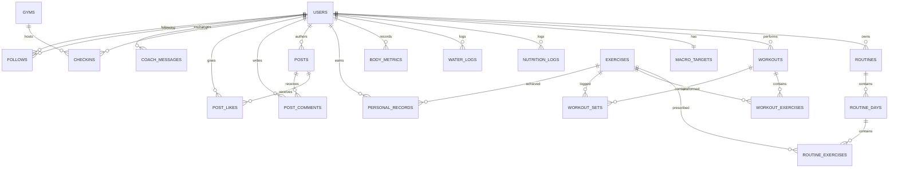

# Data Model

**Engine:** SQLite (demo) via Drizzle ORM · **Target:** Postgres 16 (production)
**Source of truth:** [`app/src/db/schema.ts`](../app/src/db/schema.ts) · **Seed:** [`app/src/db/seed.ts`](../app/src/db/seed.ts)

---

## 1. Principles

1. **User-scoped by default.** Every athlete-owned row carries `user_id`; every read is filtered by it.
2. **Immutable logs, mutable plans.** Sets and nutrition entries are append-only facts (corrections supersede, never silently rewrite). Programs are versioned plans.
3. **Timestamps are UTC.** `timestamp_ms` integers in SQLite; `timestamptz` in Postgres. Local day keys (`YYYY-MM-DD`) are stored only where the user's day is the unit (nutrition, metrics, water).
4. **IDs are opaque text** (`u-alex`, `ex-bench-press`, `wk-…`) for demo readability; production uses UUIDv7/ULID.
5. **JSON only for variable-shaped data** (equipment list, cues, instructions, post meta), not for core relational fields.
6. **Derived values are cached, not trusted.** `total_volume`, `total_sets`, `likes`, `comments` are denormalized for read speed and recomputed on write; source rows remain authoritative.

---

## 2. ERD (demo)



### Cardinality notes

- A user has **at most one active workout** (enforced in `startWorkout`; production adds a partial unique index).
- A user has **one macro target row** (`user_id` primary key).
- A set belongs to a workout **and** an exercise (denormalized `exercise_id` for fast per-exercise history).
- `workout_exercises` is the session's prescription snapshot. Editing the source program does not retroactively change a completed session.
- `follows` and `post_likes` are composite-unique pairs.
- `challenges` in the demo store `joined`/`progress` per user; production moves participation to `challenge_participants`.

---

## 3. Tables

### 3.1 `users`

| Column | Type | Notes |
| --- | --- | --- |
| `id` | text PK | `u-alex` in demo |
| `email` | text unique | Login key; lowercase-normalized |
| `name`, `handle`, `initials` | text | Display identity; handle unique |
| `accent` | text | Per-user UI accent |
| `bio` | text? | Optional |
| `goal` | text | `hypertrophy · strength · fat_loss · recomp · endurance` |
| `experience` | text | `beginner · intermediate · advanced` |
| `sex` | text | Used for strength standards; self-reported |
| `weight_kg`, `height_cm` | real | Metric storage; units converted at render |
| `unit_pref` | text | `kg · lb` (display preference) |
| `equipment` | JSON string[] | Available equipment set |
| `streak`, `xp`, `level` | integer | Gamification cache |
| `onboarded` | boolean | Onboarding gate |
| `created_at` | timestamp | |

Indexes: unique `email`, unique `handle`.

### 3.2 `exercises`

| Column | Type | Notes |
| --- | --- | --- |
| `id` | text PK | |
| `slug` | text unique | Stable human key (`bench-press`) |
| `name` | text | Display |
| `primary_muscle` | text | One of 12 `MUSCLES` keys |
| `secondary_muscles` | JSON string[] | Contribution to volume/recovery (production) |
| `equipment` | text | `barbell · dumbbell · machine · cable · bodyweight · kettlebell · bands` |
| `category` | text | `compound · isolation · conditioning` |
| `pattern` | text | `horizontal_push · vertical_push · squat · hinge · horizontal_pull · vertical_pull · lunge · carry · core · isolation` |
| `unilateral` | boolean | Per-side logging |
| `difficulty` | text | |
| `instructions` | JSON string[] | Step list |
| `cues` | JSON string[] | Technique cues |
| `tempo` | text | E.g. `2-0-1` |
| `popularity` | integer | Ranking input for swaps/search |

Indexes: unique `slug`, `primary_muscle`, `pattern`.

### 3.3 `routines` / `routine_days` / `routine_exercises`

`routines`

| Column | Type | Notes |
| --- | --- | --- |
| `id` | text PK | |
| `owner_id` | text? FK users | Null = Forge-authored |
| `name`, `subtitle`, `description` | text | |
| `goal`, `level` | text | Filters |
| `days_per_week`, `weeks` | integer | Commitment |
| `accent` | text | Card color |
| `is_public` | boolean | Marketplace visibility |
| `enrolled` | boolean | Demo single-user enrollment; production join table |
| `rating`, `members` | real/integer | Social proof cache |
| `created_at` | timestamp | |

`routine_days`: `id`, `routine_id` FK cascade, `day_index`, `name`, `focus`. Index on `routine_id`.

`routine_exercises`: `id`, `routine_day_id` FK cascade, `exercise_id` FK, `position`, `sets`, `reps_min`, `reps_max`, `rest_sec`, `rpe_target`, `superset_group`. Index on `routine_day_id`.

> **Production change:** enrollment becomes `program_enrollments(user_id, routine_id, started_at, current_day, status)` and `routine_exercises` is versioned (`program_version_id`) so a coach edit does not rewrite athlete history.

### 3.4 `workouts`

| Column | Type | Notes |
| --- | --- | --- |
| `id` | text PK | |
| `user_id` | text FK cascade | |
| `routine_id` | text? | Source program (nullable for free sessions) |
| `name`, `focus` | text | Snapshot at start |
| `status` | text | `active · completed` (production: `abandoned`) |
| `readiness` | integer | Score at start, for later analysis |
| `started_at` | timestamp | |
| `completed_at` | timestamp? | |
| `duration_sec` | integer | Wall-clock, capped client-side |
| `total_volume` | real | Σ `weight_kg × reps` for working sets |
| `total_sets` | integer | Completed working sets |
| `calories` | integer | Estimate |
| `notes` | text? | |
| `compressed` | boolean | Session was time-compressed |

Indexes: `user_id`, `status`.

### 3.5 `workout_exercises`

`id`, `workout_id` FK cascade, `exercise_id` FK, `position`, `target_sets`, `reps_min`, `reps_max`, `rest_sec`, `rpe_target`, `superset_group`, `swapped_from` (original exercise id), `notes`. Index on `workout_id`.

### 3.6 `workout_sets`

| Column | Type | Notes |
| --- | --- | --- |
| `id` | text PK | |
| `workout_id` | text FK cascade | |
| `exercise_id` | text FK | Denormalized for history query |
| `set_index` | integer | 0-based within exercise |
| `weight_kg` | real | Storage is kg |
| `reps` | integer | |
| `rpe` | real | 6–10 in 0.5 steps |
| `is_warmup` | boolean | Excluded from volume/PRs |
| `is_pr` | boolean | Set at write/finish time |
| `completed_at` | timestamp | |

Indexes: `workout_id`, `exercise_id`.

**Production additions:** `client_mutation_id` unique (idempotency), `supersedes_set_id`, `side` (`left/right`), `velocity_ms?`, `rir?`, `created_at`, `updated_at`, `deleted_at`.

### 3.7 `personal_records`

`id`, `user_id` FK, `exercise_id` FK, `type` (`weight · e1rm · reps · volume`), `value`, `reps`, `achieved_at`, `workout_id?`. Indexes: `user_id`, `exercise_id`.

**Rule:** a PR is created only when the new e1RM exceeds the historical max by ≥ 0.1 kg; ties do not spam the feed. Production adds `previous_value` and `source` for audit.

### 3.8 Nutrition

`macro_targets`: `user_id` PK/FK, `calories`, `protein`, `carbs`, `fat`, `water_ml`.

`nutrition_logs`: `id`, `user_id` FK, `date` (`YYYY-MM-DD`), `meal` (`breakfast · lunch · dinner · snack`), `name`, `serving`, `calories`, `protein`, `carbs`, `fat`, `source` (`manual · photo · barcode · voice`), `created_at`. Index `(user_id, date)`.

`water_logs`: `id`, `user_id`, `date`, `ml`, `created_at`. Index `(user_id, date)`.

**Production additions:** `food_items` (canonical database), `nutrition_log_items` (many foods per meal), `portion_grams`, `confidence`, `provider`, `provider_id`, `micronutrients` JSONB, `photo_asset_id`.

### 3.9 Recovery

`body_metrics`: `id`, `user_id`, `date`, `weight_kg?`, `body_fat?`, `sleep_hours?`, `hrv?`, `resting_hr?`, `soreness` (0–10), `steps?`. Unique `(user_id, date)`.

**Production additions:** `readiness_snapshots(user_id, date, score, inputs JSONB, model_version)` for reproducibility; wearable source and timezone.

### 3.10 Social

`gyms`: `id`, `name`, `city`, `member_count`, `busyness` (0–100 demo), `accent`.

`checkins`: `id`, `user_id`, `gym_id`, `note?`, `created_at`. Index `user_id`. Production index `(gym_id, created_at)` and a TTL view for presence.

`follows`: `(follower_id, following_id)` unique, `created_at`.

`posts`: `id`, `user_id`, `type` (`pr · checkin · workout · streak · text`), `title`, `body?`, `meta` JSON, `workout_id?`, `likes`, `comments` (counters), `created_at`. Index `created_at`.

`post_likes`: `(post_id, user_id)` unique, `created_at`.

`post_comments`: `id`, `post_id`, `user_id`, `content`, `created_at`. Index `post_id`. (Demo does not store comment likes; production adds them.)

`challenges`: `id`, `title`, `description`, `metric` (`sessions · volume · protein · streak`), `target`, `unit`, `starts_at`, `ends_at`, `participants`, `accent`, `joined`, `progress`.

**Production additions:**
- `challenge_participants(challenge_id, user_id, progress, joined_at, completed_at)` unique pair.
- `post_media`, `reports`, `blocks`, `moderation_actions`.
- Feed fan-out table or Redis cache; celebrity posts pulled, normal posts pushed.

### 3.11 Coach

`coach_messages`: `id`, `user_id`, `role` (`user · coach`), `content`, `created_at`. Index `user_id`.

**Production additions:** `conversations`, `message_citations` (JSONB of workspace facts used), `model`, `prompt_version`, `tokens_in/out`, `latency_ms`, `flagged`.

---

## 4. Index strategy

| Query | Index |
| --- | --- |
| Workspace loads by user | `workouts(user_id, status)`, `nutrition_logs(user_id, date)`, `body_metrics(user_id, date)` |
| Exercise history | `workout_sets(exercise_id, completed_at)` (production) |
| Feed | `posts(created_at desc)` |
| Comments | `post_comments(post_id, created_at)` |
| Leaderboard | Redis sorted set; fallback `workouts(user_id, completed_at)` + aggregate |
| Exercise filter | `exercises(primary_muscle)`, `exercises(pattern)` |
| Program days | `routine_days(routine_id, day_index)` |
| PR lookups | `personal_records(user_id, exercise_id, achieved_at)` |

**Rules:** every FK gets an index in production (SQLite demo omits some for brevity). Composite indexes ordered by equality columns first, then range/sort. Verify with `EXPLAIN ANALYZE`, not intuition.

---

## 5. Data integrity

### Demo constraints
- Drizzle FKs with `ON DELETE CASCADE` for user-owned rows.
- Unique indexes on email, handle, exercise slug, follows pair, likes pair, body metric day.
- Application-level: one active workout per user; set index unique per exercise/workout; macro values non-negative; RPE 1–10.

### Production constraints
```sql
-- one active session per user
CREATE UNIQUE INDEX one_active_workout
  ON workouts (user_id) WHERE status = 'active';

-- idempotent set logging
ALTER TABLE workout_sets ADD CONSTRAINT set_mutation_unique
  UNIQUE (client_mutation_id);

-- no duplicate PR per workout/exercise/type
CREATE UNIQUE INDEX pr_once ON personal_records (workout_id, exercise_id, type)
  WHERE workout_id IS NOT NULL;

-- positive loads / sane reps
ALTER TABLE workout_sets ADD CONSTRAINT set_values CHECK (
  weight_kg >= 0 AND reps BETWEEN 0 AND 100 AND rpe BETWEEN 1 AND 10
);
```

### Referential rules
- Deleting a user cascades private data; posts may be anonymized instead of deleted to preserve community context (policy decision).
- Deleting an exercise is forbidden if referenced; archive it (`archived_at`) and hide from search.
- Completed workouts are immutable except notes and corrections; corrections create a new set row with `supersedes_set_id`.

---

## 6. Aggregations & derived data

| Metric | Definition | Where |
| --- | --- | --- |
| Volume | Σ `weight_kg × reps` for non-warmup sets | Session finish + display query |
| e1RM | `weight × (1 + reps/30)` (Epley) | Engine, PR detection |
| Weekly volume | Sum per ISO week, user timezone | `weekVolumeSeries` |
| Muscle volume | Sets × primary muscle mapping | `muscleVolume`, recovery map |
| Readiness | Weighted sleep/HRV/RHR/soreness | `readinessScore` |
| Recovery % | 100 − Σ stress × decay | `recoveryMap` |
| Protein remaining | `max(0, target − logged)` | `nutritionTotals` |
| Streak | Consecutive weeks with ≥ 2 sessions (demo: seeded) | User cache, recomputed on finish |
| XP | `sets × 10 + volume/100 + PR × 50` style | Finish action |
| Level | Threshold curve on XP | Finish action |

**Consistency:** counters (`likes`, `comments`, `participants`) update in the same transaction as the source row. Nightly reconciliation job compares counters to `COUNT(*)` and repairs drift.

---

## 7. Retention & privacy

| Data | Retention (production) | Notes |
| --- | --- | --- |
| Account profile | Until deletion + 30-day grace | Export available |
| Workouts/sets | Indefinite while account active | Core product value |
| Form analyses (derived metrics) | 12 months default | User can delete; no video by default |
| Form video (opt-in) | 7 days | Encrypted, signed URLs, auto-delete |
| Food photos | 30 days or until log confirmed | Then delete unless user saves |
| Coach messages | 12 months | Redacted logs for evals, opt-out |
| Analytics events | 24 months aggregated | No free-text/PII by default |
| Backups | 30 days PITR | Deletion propagated within 30 days |
| Moderation evidence | 12 months | Restricted access |

**Deletion:** hard-delete private rows, anonymize posts (`user_id → deleted-user`), revoke sessions, enqueue search/cache purge, confirm by email. Document sub-processors.

**Export:** JSON (full fidelity) + CSV (sets, nutrition, body metrics) generated async, signed URL valid 24 h.

---

## 8. Migrations

### Demo
- `npx drizzle-kit push --force` applies schema.
- `npx tsx src/db/seed.ts` clears and reseeds deterministic demo data.

### Production
- Drizzle migrations checked into repo; generated SQL reviewed.
- Expand → backfill → switch reads → contract. No destructive change in one deploy.
- Backfills idempotent, batched, resumable; progress in `job_runs`.
- Schema version exposed in health endpoint; app refuses to start on incompatible version.
- Zero-downtime requirement for writes: new columns nullable or defaulted; indexes created concurrently.
- Rollback plan per migration; data migrations have forward-fix scripts.

### Naming
`snake_case` tables/columns; plural tables; `_at` timestamps; `_id` FKs; booleans `is_*` or past-participle where clearer; enums as text + check constraint (portable, easy to extend).

---

## 9. SQLite → Postgres mapping

| SQLite | Postgres |
| --- | --- |
| `text` ids | `uuid` (UUIDv7) or `text` for stable slugs |
| `integer timestamp_ms` | `timestamptz` |
| JSON text | `jsonb` (indexable with GIN) |
| `real` | `numeric(6,2)` for loads; `real` for derived |
| Boolean integer | `boolean` |
| No RLS | Row-level security policies |
| Single writer | Connection pool + replicas |
| `AUTOINCREMENT` not used | `bigint generated always as identity` for event tables |
| Full-text `LIKE` | `tsvector` + GIN; trigram for fuzzy search |

**Porting checklist:** types, defaults, JSON operators, upserts (`ON CONFLICT`), timestamp modes, boolean comparisons, case-insensitive email (citext or lower index), timezone handling, and sequence/identity strategy.

---

## 10. Production schema additions (summary)

```sql
-- identity & auth
auth_identities (id, user_id, provider, provider_user_id, email, created_at)
sessions (id, user_id, refresh_token_hash, device, ip, expires_at, revoked_at)

-- programs
program_enrollments (id, user_id, routine_id, started_at, current_day, status)
program_versions (id, routine_id, version, published_at, changelog)

-- sync & audit
client_mutations (id, user_id, client_mutation_id UNIQUE, type, payload, applied_at)
audit_log (id, actor_id, action, target_type, target_id, meta, created_at)

-- nutrition
food_items (id, name, brand, serving_grams, kcal, protein, carbs, fat, micros, source, verified)
nutrition_log_items (id, log_id, food_id, grams, confidence)
photo_assets (id, user_id, storage_key, status, expires_at)

-- social
challenge_participants (challenge_id, user_id, progress, joined_at, completed_at)
post_media (id, post_id, asset_id, position)
reports (id, reporter_id, target_type, target_id, reason, status, created_at)
blocks (blocker_id, blocked_id, created_at)

-- ai & observability
readiness_snapshots (id, user_id, date, score, inputs, model_version)
form_analyses (id, user_id, lift, metrics, score, model_version, created_at)
coach_conversations (id, user_id, title, created_at)
coach_citations (message_id, fact_type, fact_id, value)
```

---

## 11. Seed dataset (demo)

| Entity | Count | Notes |
| --- | --- | --- |
| Users | 7 | Alex + 6 community athletes |
| Exercises | 63 | Across 12 muscles, 7 equipment types |
| Routines | 4 | Hypertrophy Forge, Foundation 5×5, PowerBuild, Metcon Shred |
| Routine days | 15 | |
| Routine exercises | 68 | |
| Workouts | 35 | 12 weeks of history |
| Workout exercises | 175 | |
| Workout sets | 561 | With RPE and timestamps |
| PRs | 23 | e1RM and weight |
| Nutrition logs | 11 | Today + recent days |
| Body metrics | 85 | 12 weeks of sleep/HRV/weight |
| Posts | 6 | PRs, check-ins, streaks |
| Comments | 6 | |
| Challenges | 3 | |
| Coach messages | 3 | |

Seed is deterministic relative to `today` so charts and “last trained” labels stay coherent. Total seeded volume ≈ 229,744 kg.

---

## 12. Open data questions

1. Should sets be event-sourced (append-only) for audit and ML, with a materialized current view? Leaning yes for production.
2. How long should raw pose coordinates be retained, if at all? Default: not stored; derived metrics only.
3. Do we store food photos after confirmation? Default: delete, unless user opts in for revisit.
4. Should coach conversations be usable for model improvement? Opt-in only, with redaction and compensation policy.
5. Multi-region data residency: per-user region pinning adds complexity; defer until EU enterprise demand is proven.
6. Challenge integrity: server-side verification of volume/sessions vs. trusting client logs (which can be edited). Need anti-cheat rules.
