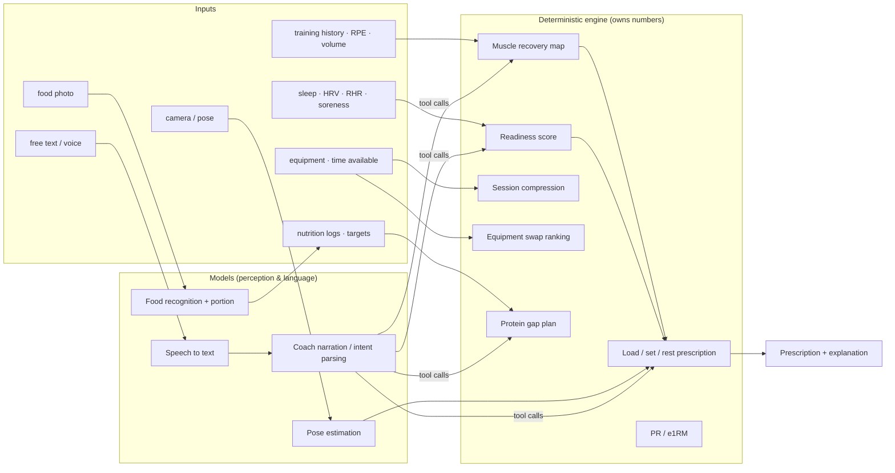

# AI & Adaptive Systems

**Principle:** the deterministic engine owns the numbers. Models narrate, classify or perceive — they do not invent load, calories or medical advice.

**Related:** [`04-architecture.md`](04-architecture.md), [`05-data-model.md`](05-data-model.md), [`03-prd.md`](03-prd.md)

---

## 1. System map



**Hard rules**
1. Any number shown as a prescription is produced by a pure function with visible inputs.
2. An LLM may request a tool (`get_readiness`, `get_protein_gap`) but may not compute or alter the result.
3. Perception outputs carry confidence; below threshold the UI asks for confirmation or says “unavailable”.
4. No diagnosis, no rehab protocol, no “safe to train through pain”.

---

## 2. Readiness model

### Implemented (demo)
`readinessScore({ sleepHours, hrv, restingHr, soreness })`

| Component | Formula | Max points |
| --- | --- | --- |
| Sleep | `clamp((sleep − 5.5) / 3, 0, 1) × 34` | 34 |
| HRV | `clamp((hrv − 40) / 45, 0, 1) × 30` | 30 |
| Resting HR | `clamp((70 − rhr) / 20, 0, 1) × 16` | 16 |
| Soreness | `clamp(1 − soreness/10, 0, 1) × 20` | 20 |
| Base | constant | 12 |
| Output | `round(clamp(sum, 20, 99))` | 20–99 |

Defaults when missing: sleep 7 h, HRV 62, RHR 56, soreness 3.

### Bands → prescription
| Score | Label | Prescription |
| --- | --- | --- |
| ≥ 85 | Primed | Push top set; PR attempt allowed |
| 70–84 | Ready | Train as planned; auto-regulate last set |
| 55–69 | Moderate | Keep volume; drop intensity 5–8%; quality reps |
| < 55 | Depleted | Deload or zone-2; recovery is the workout |

### Why this shape
- Sleep is the strongest evidence-backed recovery input for strength performance; weighted highest.
- HRV is informative but noisy day-to-day; capped contribution and smoothed over 7 days in production.
- Resting HR is a weak signal alone; low weight.
- Soreness is subjective but actionable; it also feeds the per-muscle map.

### Production upgrades
- Personal baselines (30-day rolling z-scores) instead of population constants.
- 7-day smoothed HRV/RHR; sleep debt (7-day cumulative vs. need).
- Cycle-phase adjustment for users who opt in.
- Learned weights from outcome data (session completion, RPE drift, PR rate) with a held-out validation set.
- Confidence interval; if inputs are missing/stale, show “estimated” and reduce authority.
- Model version stored in `readiness_snapshots` for reproducibility.

### Failure modes
| Failure | Guard |
| --- | --- |
| Wearable sync stale | Show last-sync time; fall back to subjective check-in |
| User ignores score | Never block training; suggestion only; one-tap override |
| Score feels wrong | “Why this score?” panel with inputs; feedback button |
| Overfitting to one athlete | Population prior + personal blend; evaluate per cohort |

---

## 3. Per-muscle recovery

### Implemented (demo)
For each completed set in the last 8 days:

```
stress = (1 + min(1.4, weightKg × reps / 1400)) × exp(−ageDays / 2.6)
recovery[muscle] = clamp(100 − Σ (stress × 5.2), 8, 100)
```

- `weight × reps` proxies mechanical work; capped so a heavy single doesn't dominate.
- Exponential decay with a 2.6-day time constant: ~50% stress resolved in 1.8 days, ~90% by 6 days.
- 8-day cutoff prevents ancient sessions from suppressing recovery.
- Muscles with no recent sets show 100%.
- `lastTrained` recorded for “3 days ago” labels.

### Interpretation
| Recovery | Meaning | UI |
| --- | --- | --- |
| 80–100 | Ready | Acid/green |
| 55–79 | Recovering | Amber |
| 30–54 | Fatigued | Orange |
| 8–29 | Highly fatigued | Flame/red |

### Production upgrades
- Per-muscle set contribution weighted by secondary muscles (e.g., bench → chest 1.0, triceps 0.5, shoulders 0.5).
- Intensity via % e1RM or RPE rather than raw tonnage.
- Fiber-type / exercise-specific recovery (squat vs. leg extension) rather than one quad value.
- Individual recovery rate learned from “how did the next session feel” labels.
- Deload detection when 3+ muscles stay < 50% for 7 days.

### Guardrails
- Recovery is a **training-planning heuristic**, not a medical assessment. Copy says “estimated fatigue”, never “injured” or “unsafe”.
- Never hide a workout because of recovery; offer an adapted one.

---

## 4. Load autoregulation

### Implemented (demo)
After a set is logged with RPE:

| Last RPE | Next-set suggestion | Reason shown |
| --- | --- | --- |
| ≥ 9.5 | `roundTo(weight × 0.95)` | “Protect quality” |
| 9.0–9.4 | Hold weight, cap reps | “Grinding; repeat, don't add” |
| 7.0–8.9 | Hold weight / double progression | “On target” |
| ≤ 6.5 | `+2.5 kg` (or +1.25 for small lifts) | “Green light” |

Initial suggestion per exercise comes from history: last working weight adjusted by readiness band and target reps. Bodyweight movements use 0 load.

### Production algorithm
1. **Estimate e1RM** from the top recent set (`weight × (1 + reps/30)`, or a learned reps-to-failure curve).
2. **Target % e1RM** from program intent: hypertrophy 65–80%, strength 80–90%, peaking 90%+.
3. **Readiness multiplier:** 1.00 (ready), 0.95 (moderate), 0.88 (depleted), 1.03 (primed, optional).
4. **RPE feedback:** if observed RPE > target + 1, reduce next load 5%; if < target − 1 and reps hit top of range, increase 2.5–5 kg.
5. **Double progression:** reps climb within range before load increases; isolates get smaller increments.
6. **Fatigue management:** if e1RM drops > 8% within a session, cut remaining sets or rest longer.
7. **Deload trigger:** 3 weeks of rising RPE at fixed load, or recovery < 50% for 3+ muscles, or readiness < 55 for 4 of 7 days.

### Explanation contract
Every suggestion carries:
```json
{
  "action": "increase_load",
  "fromKg": 80,
  "toKg": 82.5,
  "reason": "Last set RPE 6.5 at top of rep range; readiness 78",
  "confidence": "high",
  "inputs": ["lastRpe", "repRange", "readiness"],
  "overridable": true
}
```

### Safety
- Hard cap rate of increase per week (e.g., +10% e1RM for upper, +15% lower) unless user explicitly overrides.
- Never auto-add load on a lift with pain flagged.
- User can lock a lift's prescription (“don't change my bench”).

---

## 5. Session compression

### Implemented (demo)
`estimateSessionMinutes(exercises)`:

```
minutes = 8 (warm-up)
        + Σ targetSets × (42s set + restSec)   // rest × 0.35 if superset
```

`compressSession(exercises, targetMinutes)`:
- Pairs consecutive exercises into supersets (A1/A2), leaving an odd last exercise straight.
- Halves rest (`restSec × 0.5`; estimate also applies superset discount).
- Preserves sets and reps; does not silently cut volume.
- Returns `originalMin`, `compressedMin`, groups, and the modified exercise list.
- `compressedMin = max(targetMinutes, round(originalMin × 0.6))`.

### Why this is honest
- Supersets genuinely save time by overlapping rest, at a modest performance cost.
- The UI shows original vs. compressed time and warns that top-set performance may drop slightly.
- “Minimum effective dose” mode (production) can also trim accessories and keep the main lift.

### Production upgrades
- Constraint solver: respect equipment availability, superset compatibility (not two barbell movements), user preference, and warm-up needs.
- Model actual set duration from history rather than 42 s.
- Offer three modes: **Keep volume** (supersets), **Keep intensity** (cut accessories), **Keep main lift** (shortest).
- Learn acceptance and completion by mode.

---

## 6. Equipment swap ranking

### Implemented (demo)
Score for every exercise with available equipment:

| Signal | Points |
| --- | --- |
| Same movement pattern | +50 |
| Same primary muscle | +30 |
| Same category | +8 |
| Target muscle is a secondary mover | +6 |
| Popularity | + popularity/12 |
| Bodyweight | +6 |
| **Threshold** | score ≥ 35, top 5 |

Reasons are attached (“Same movement pattern”, “Zero equipment”). Swapping preserves position, target sets, and logged sets; `swapped_from` records the original.

### Production upgrades
- Movement-compatibility graph (not just pattern string): joint action, range, unilateral/bilateral, axial loading, skill demand.
- Equipment state: user's home inventory + gym machine availability from check-ins.
- Contralateral risk: avoid swapping a hinge for a movement that loads the lower back if the user flagged back sensitivity.
- Learned substitution preferences from accepted/rejected swaps.

---

## 7. Nutrition intelligence

### 7.1 Protein-gap generator (implemented)
Input: remaining protein (target − logged), optional filter (veg/vegan/home/fast).
Greedy selection from a curated food list:
- Sort by protein descending.
- Add foods while they fit the remaining gap (+4 g tolerance).
- Stop at 3 items; if still short, add the closest single food.
- Return name, serving, protein, calories, tags.

Properties: deterministic, ≤ 3 items, closes within ~5 g, calorie-aware enough to avoid absurd totals. It is a **suggestion**, not a prescription; user can swap items.

### 7.2 Photo-to-macro (demo)
- UI simulates recognition with a curated regional set.
- User confirms dish and portion; macros are edited before logging.
- `source = "photo"` stored for provenance.
- No image leaves the device in the demo.

### 7.3 Production pipeline
1. **Capture:** downscale, EXIF strip, local inference preferred.
2. **Detection:** multi-food segmentation; plate/bowl detection for scale.
3. **Classification:** regional dish classifier (top-k with confidence); fallback to ingredient decomposition.
4. **Portion:** depth/scale cues + user household measures (katori, roti, cup); never pretend gram precision from a single RGB image.
5. **Nutrition lookup:** canonical food DB + recipe decomposition; USDA/Open Food Facts + regional partners.
6. **Confirmation UX:** top-3 candidates, editable portions, “not this” corrections.
7. **Learning:** corrections become labeled data (consented); per-user priors for habitual foods.
8. **Guardrails:** flag low confidence; show range; never log without confirmation.

### 7.4 Metrics
Top-1 / top-3 dish accuracy; portion MAE; calorie MAE; confirmation rate; correction rate; time-to-log; percentage of logs edited later.

### 7.5 Protein timing (production)
- Distribute protein across 3–5 feedings; 0.25–0.4 g/kg per meal; 1.6–2.2 g/kg/day for hypertrophy.
- Pre/post training window is a soft preference, not a hard rule.
- GLP-1 users: prioritize protein density, smaller volumes, resistance training; clinician collaboration, no medical claims.
- Never prescribe for renal disease or eating disorders; route to professional.

---

## 8. Form analysis

### 8.1 Demo
- Webcam is opt-in; `getUserMedia` only after a click; stop control releases tracks.
- A 17-joint SVG skeleton is animated over the video with lift-specific angles.
- Metrics, rep count, score, cues and wins are deterministic fixtures per lift (squat/bench/deadlift).
- The UI labels the analysis as a simulation; no frames leave the browser.

### 8.2 Production pipeline (on-device first)
```
camera → frame sampler (15–30 fps) → pose model (MediaPipe/MoveNet)
      → smoothing (One Euro / Kalman) → lift classifier
      → phase segmentation (setup, eccentric, bottom, concentric, lockout)
      → rep counter (state machine with hysteresis)
      → biomechanics features → rule/ML scorer → cue selector
      → overlay + one cue + summary
```

### 8.3 Features
| Lift | Features |
| --- | --- |
| Squat | Depth (hip below knee), torso inclination, knee valgus, heel lift, bar path, tempo, symmetry |
| Bench | Elbow flare, bar path, touch point consistency, shoulder shrug, lockout, tempo |
| Deadlift | Bar path, hip rise vs. shoulder rise, lumbar flexion proxy, lockout, setup consistency |
| Overhead press | Lumbar extension, elbow path, bar drift, lockout |
| Row/pull-up | Torso swing, range, scapular timing, symmetry |

### 8.4 Scoring
Weighted rubric per lift (e.g., squat: depth 30%, torso 20%, knee tracking 20%, tempo 15%, consistency 15%). Score 0–100. Cues are prioritized by (severity × confidence × actionability); only one primary cue is shown mid-set.

### 8.5 Model strategy
- **Start with rules on pose keypoints.** Explainable, cheap, no labeled dataset required.
- Add a learned classifier when ≥ 5k labeled clips exist, evaluated against coach labels.
- Per-user baseline: compare to the athlete's own best reps, not an idealized model.
- Confidence gating: poor lighting/occlusion → “move camera / more light”, never a fake score.

### 8.6 Evaluation
- Rep-count F1 vs. manual annotation (target ≥ 0.95).
- Joint-angle MAE (target < 8° for squat depth).
- Cue agreement with certified coaches (Cohen's κ ≥ 0.6 for primary cue).
- False-positive injury-flag rate near zero; no injury claims at all.
- Latency: < 100 ms per frame on mid-tier phone; < 30 ms on flagship.
- Fairness: evaluate across body types, skin tones, clothing, gym lighting, wheelchair variants where relevant.

### 8.7 Privacy & safety
- Video never uploaded by default; coordinates processed on-device.
- If server fallback is used: explicit consent, encrypted upload, 7-day deletion, no training without opt-in.
- No diagnosis; language is “your knees moved inward ~2 cm” not “you have valgus deformity”.
- Pain flag → stop and recommend a professional.
- Minors: stricter defaults, no social sharing of form clips.

---

## 9. Coach (LLM in production, deterministic in demo)

### 9.1 Demo
`lib/coach.ts` generates replies from workspace facts:
- readiness score + inputs
- protein remaining
- muscles with lowest recovery
- next program day
- available equipment
- recent PRs
- streak

It answers common intents (what to train, adjust for sleep, protein, swap, plateau, deload, motivation) with specific numbers. History persists in `coach_messages`.

### 9.2 Production architecture
```
user message
  → intent + entity extraction (small model or rules)
  → tool plan (read-only workspace tools)
  → tool execution (authorized, user-scoped)
  → response composition (LLM, structured facts only)
  → safety filter → citations → stream
```

### Tools (read-only first)
`get_readiness(date)` · `get_recovery()` · `get_next_session()` · `get_recent_sets(exercise)` · `get_prs()` · `get_nutrition(date)` · `get_protein_gap()` · `get_equipment()` · `get_program()` · `get_streak()`

Write actions (later, with confirmation): `swap_exercise`, `compress_session`, `log_meal`, `adjust_targets`. Every write requires an explicit UI confirmation and is auditable.

### Guardrails
- System prompt: no diagnosis, no guaranteed outcomes, no extreme dieting, no PED advice, escalate pain/eating-disorder/medical questions.
- Numeric claims must come from tool results; post-generation check rejects unsupported numbers.
- Prompt injection: user content never becomes system instructions; tools have fixed schemas; no browsing/secrets.
- Cost: cache workspace summary; cap tokens; route simple intents to templates; per-tier monthly cap.
- Latency: stream first token < 1.5 s p95; fallback to deterministic coach on timeout.
- Evaluation: golden set of 200 prompts × personas; factuality, safety, helpfulness, tone; human review weekly.
- Transparency: “Based on your last 4 weeks” + citations; “AI can be wrong” disclosure.

### Why deterministic first
Trust. A coach that says “your protein is 60 g short” must be right every time. Templates over real data are boring but correct; the LLM adds flexibility once the facts layer is bulletproof.

---

## 10. Voice & natural-language logging

### Implemented (demo)
Regex parse of `"<exercise?> <weight> for <reps> [at rpe <n>]"` with kg/lb/kilos/pounds support. The parsed values populate the draft; the user must confirm by logging. Failure shows a helpful example.

### Production
- ASR (Whisper-class) on-device or streaming; language detection.
- Intent schema: `{ exercise, weight, unit, reps, rpe?, setIndex? }`.
- Entity resolution against the user's program and exercise aliases (“bench” → bench press; “RDL” → Romanian deadlift).
- Confidence thresholds; ambiguity prompts (“Which bench — barbell or dumbbell?”).
- Never auto-submit; always show a confirmation chip.
- Offline: queue audio or parsed draft locally; transcribe when online if on-device ASR unavailable.
- Privacy: audio deleted immediately after transcription; no retention by default.

---

## 11. PR detection & progression

### Implemented
- e1RM = `weight × (1 + reps/30)` (Epley).
- A set is a PR if e1RM > historical best for that exercise (0.1 kg tolerance).
- Also tracks weight PRs; seeded PR rows.
- Celebration in live session; summary aggregates; share card renders.

### Production
- Separate rep-max PRs (1RM, 3RM, 5RM, 10RM) with confidence.
- Normalize units; ignore warm-ups; require ≥ 1 working set at prescribed depth (manual flag).
- Detect “technical PR” vs. “grinder” using RPE/velocity; celebrate both but label.
- Streak/XP anti-abuse: cap XP per day; ignore implausible loads (e.g., 500 kg bench) until verified.
- Progression: double progression by default; block periodization for strength; auto-deload.

---

## 12. Evaluation & MLOps

### Data
- Event log (ClickHouse) + labeled subsets: RPE, readiness, form clips, food photos, coach ratings.
- Consent and de-identification; no training on private data without opt-in.
- Versioned datasets with train/val/test splits by user (not by row) to avoid leakage.

### Offline evaluation
| System | Metric | Target |
| --- | --- | --- |
| Readiness | Correlation with next-session performance | r ≥ 0.3 |
| Recovery | Calibration vs. athlete “ready” labels | ECE ≤ 0.1 |
| Autoreg | Load recommendation error vs. coach | MAE ≤ 5% |
| Compression | Predicted vs. actual duration | MAE ≤ 4 min |
| Swap | Acceptance rate | ≥ 40% |
| Protein plan | Gap closure within tolerance | ≥ 90% |
| Form | Rep F1 / cue agreement | ≥ 0.95 / κ ≥ 0.6 |
| Food | Top-3 dish accuracy / calorie MAE | ≥ 85% / ≤ 20% |
| Coach | Factuality / safety pass | ≥ 98% / 100% |

### Online evaluation
- A/B tests with guardrails (retention, session completion, adaptation acceptance, support tickets).
- Counterfactual logging for prescriptions (log what would have been suggested vs. chosen).
- Monitor drift: input distribution, acceptance rate, override rate, model latency/cost.
- Rollback: model version pinning, shadow mode for new models, kill switch per feature.

### Human-in-the-loop
- Coach review queue for low-confidence form/food outputs.
- Expert (S&C, RD) sign-off on cue libraries and nutrition templates.
- Incident process for harmful advice; audit trail.

---

## 13. Safety, ethics & regulation

- **Not medical software.** No diagnosis, treatment, or rehab prescription. Clear disclaimers at onboarding and in form/nutrition surfaces.
- **Eating disorders:** screen with a validated brief tool at onboarding; block aggressive deficits; surface support resources; human escalation.
- **Minors:** guardian consent where required; no body-fat shaming; no social comparison defaults.
- **GLP-1 / medication:** do not advise dosing; collaborate with clinicians; focus on protein and resistance training.
- **Pregnancy/postpartum:** require clinician clearance; conservative templates; no intensity maximization.
- **Disability:** inclusive exercise alternatives; form models evaluated on varied bodies; no “normal” shaming.
- **Data:** consent, export, delete, residency; no sale of health data; DPA with sub-processors.
- **Explainability:** every adaptive output has a “why” surface; users can override and lock preferences.
- **Regulatory watch:** FDA general wellness vs. medical device claims; EU MDR if diagnostic claims are made; state privacy laws; app-store health policies.

---

## 14. Build sequence

| Phase | Deliverable | Why first |
| --- | --- | --- |
| 1 | Deterministic engine + tests | Trust and correctness; no model risk |
| 2 | Real LLM coach with read-only tools | Highest user-visible AI value, low safety risk |
| 3 | On-device pose MVP (squat) | Privacy-preserving, clear evaluation |
| 4 | Food photo top-3 + confirmation | Value even at imperfect accuracy |
| 5 | Learned readiness/autoreg models | Needs longitudinal data at scale |
| 6 | Write-action coach with confirmation | Automation with audit and rollback |

**Do not build in this order:** generic chatbot → generated plans → social feed. That sequence optimizes demo novelty over retention.

---

## 15. Open questions

1. How much readiness authority should the app have before users revolt? (Suggestion-first is safer.)
2. Can we validate recovery against actual performance without an RCT? (Observational + holdout.)
3. What is the minimum labeled form dataset for a trustworthy squat cue? (Start rules, then 5k clips.)
4. Should food recognition run fully on-device? (Privacy vs. accuracy; hybrid likely.)
5. How do we prevent LLM coach sycophancy while staying motivating? (Grounded facts + tone eval.)
6. What is the ethical line for streak/XP mechanics? (Forgiveness, no shame, no dark patterns.)
7. Do we expose readiness/recovery APIs to coaches? (Consent + aggregate only.)
